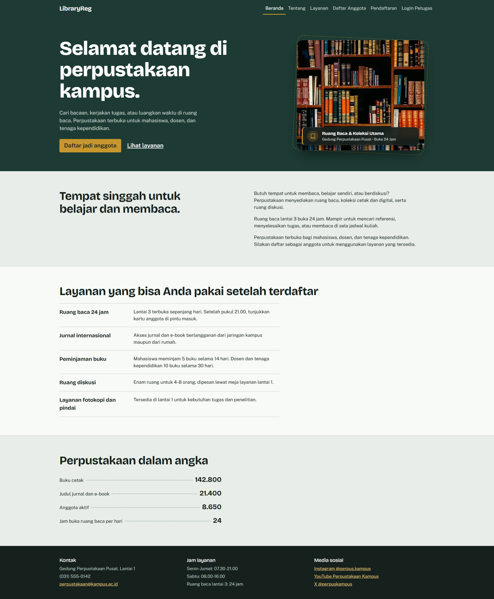
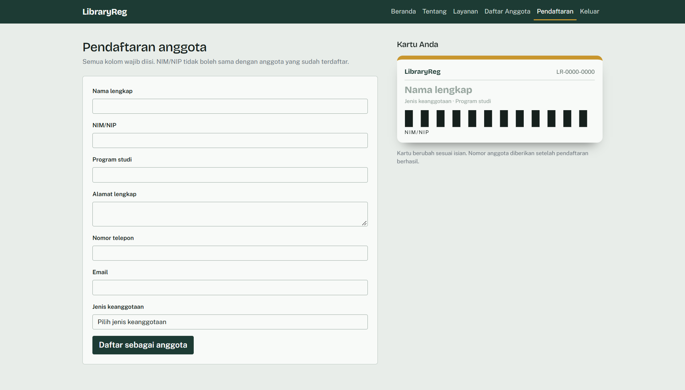
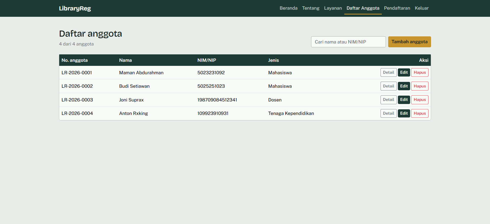
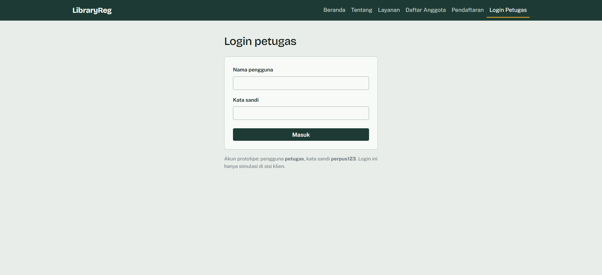

# LAPORAN EVALUASI TENGAH SEMESTER (ETS)
## PEMROGRAMAN WEB

---

**Informasi Mahasiswa:**
- **Nama:** Asher Yedijah Hoesono
- **NRP:** 5025251106
- **Mata Kuliah:** Pemrograman Web
- **Nama Proyek:** LibraryReg – Sistem Informasi & Pendaftaran Anggota Perpustakaan Kampus

---

## 1. Deskripsi dan Ruang Lingkup Pekerjaan

### 1.1 Latar Belakang & Permasalahan
Perpustakaan perguruan tinggi memiliki peran vital dalam menunjang aktivitas tri dharma civitas akademika. Kendati demikian, banyak unit perpustakaan yang masih menggunakan metode manual berbasis kertas (*paper-based form*) dalam proses registrasi anggota baru. Metode konvensional ini memicu sejumlah persoalan operasional:
1. Terjadinya antrean panjang dan penumpukan pemohon pada periode penerimaan mahasiswa baru.
2. Tingginya risiko salah ketik (*human error*) saat petugas menyalin data dari formulir fisik ke buku induk pendaftaran.
3. Lambatnya penerbitan kartu identitas keanggotaan dan kesulitan dalam melacak riwayat anggota secara instan.
4. Lemahnya validasi data di awal (misal: duplikasi NIM/NIP atau kesalahan format kontak).

### 1.2 Tujuan Proyek
Proyek **LibraryReg** bertujuan merancang dan mengimplementasikan aplikasi web *front-end* yang memodernisasi alur registrasi anggota perpustakaan secara mandiri (*self-service registration*), menyediakan kartu anggota digital secara instan, serta memfasilitasi petugas perpustakaan dalam mengelola data keanggotaan secara cepat, akurat, dan interaktif.

### 1.3 Ruang Lingkup Pekerjaan
Ruang lingkup pekerjaan pada prototipe web ini mencakup:
- **Pengembangan Sisi Klien (*Client-Side Front-End*):** Menggunakan HTML5 semantik, CSS3 modern dengan variabel kustom, Bootstrap 5 untuk tata letak responsif, serta JavaScript murni (*vanilla ES6+*) untuk memanipulasi DOM dan logika aplikasi tanpa dependensi *server-side* yang berat.
- **Landing Page Interaktif:** Halaman utama representatif berisi perkenalan fasilitas, direktori layanan, statistik koleksi, dan navigasi terpadu.
- **Formulir Pendaftaran & Validasi Ketat:** Validasi data formulir *real-time* di sisi klien mencakup kelengkapan data (*required fields*), pola regex email, pembatasan karakter nomor telepon, serta pengecekan keunikan NIM/NIP untuk mencegah duplikasi data.
- **Pembuatan Kartu Anggota Digital:** Pembuatan kartu identitas otomatis dilengkapi dengan *barcode* dinamis berbasis SVG yang digenerate langsung dari kode NIM/NIP anggota.
- **Dashboard Pengelolaan Data Anggota (CRUD):**
  - **Create:** Menambah anggota baru dari formulir pendaftaran.
  - **Read:** Menampilkan daftar anggota pada tabel responsif lengkap dengan fitur pencarian instan (*live search* filter) berdasarkan nama atau NIM/NIP, serta tombol lihat pratinjau kartu anggota.
  - **Update:** Fasilitas penyuntingan data anggota via modal interaktif dengan sinkronisasi langsung.
  - **Delete:** Penghapusan data anggota disertai dialog konfirmasi modal (*SweetAlert2*).
- **Persistensi Data Lokal:** Penyimpanan seluruh basis data anggota secara persisten pada browser pengguna melalui `window.localStorage`.
- **Manajemen Sesi Petugas:** Autentikasi berbasis status sesi menggunakan `sessionStorage` untuk membedakan hak akses petugas perpustakaan.

---

## 2. Rancangan Halaman dan Struktur Menu

### 2.1 Struktur Navigasi (Sitemap)
Aplikasi LibraryReg dirancang dengan arsitektur navigasi datar (*flat hierarchy*) yang intuitif sehingga memudahkan pengguna umum maupun petugas:

```text
LibraryReg Web Application
├── 1. Beranda (index.html)
│   ├── Hero Section (Pengenalan & CTA Pendaftaran)
│   ├── Tentang Perpustakaan (#tentang)
│   ├── Layanan Unggulan (#layanan)
│   ├── Statistik Buku & Anggota
│   └── Footer (Kontak, Jam Layanan, Media Sosial)
├── 2. Pendaftaran (pendaftaran.html)
│   ├── Formulir Registrasi Anggota Baru
│   └── Live Preview Kartu Anggota (Dinamis sesuai isian)
├── 3. Daftar Anggota / Dashboard Petugas (daftar-anggota.html)
│   ├── Pencarian Anggota (Live Filter)
│   ├── Tabel Data Anggota Lengkap
│   ├── Modal Detail Kartu Anggota
│   └── Modal Edit Data Anggota
└── 4. Login Petugas (login.html)
    └── Form Autentikasi Pengelola Perpustakaan
```

### 2.2 Struktur Menu & Navbar
Navbar dirancang bersifat *sticky* di bagian atas layar dengan indikator status aktif (`.active`) pada halaman atau section yang sedang dibuka:
- **Beranda:** Mengarah ke `index.html#beranda`.
- **Tentang:** Mengarah ke `index.html#tentang` (scroll otomatis ke deskripsi fasilitas).
- **Layanan:** Mengarah ke `index.html#layanan` (scroll otomatis ke informasi layanan).
- **Daftar Anggota:** Membuka `daftar-anggota.html` untuk memantau data seluruh anggota terdaftar.
- **Pendaftaran:** Membuka `pendaftaran.html` untuk mengisi form registrasi baru.
- **Login / Keluar Petugas:** Menu dinamis yang menampilkan **Login Petugas** saat belum masuk sesi, dan otomatis berubah menjadi **Keluar** saat petugas sedang dalam sesi aktif.

### 2.3 Tangkapan Layar Antarmuka Halaman
Berikut adalah visualisasi antarmuka dari seluruh halaman yang telah diimplementasikan:

#### A. Halaman Beranda (Landing Page)
Menampilkan hero section penyambutan, visual estetis perpustakaan, section tentang, direktori layanan, dan statistik buku besar.


#### B. Halaman Pendaftaran Anggota
Menyediakan formulir pendaftaran anggota dengan live card preview di sisi kanan yang otomatis terupdate seiring pengguna mengetikkan data.


#### C. Halaman Pengelolaan / Daftar Anggota
Menampilkan dashboard petugas dengan pencarian cepat (*live search*), aksi CRUD (lihat detail kartu, edit data anggota, dan hapus anggota).


#### D. Halaman Login Petugas
Menyediakan antarmuka autentikasi bagi pengelola perpustakaan untuk mengaktifkan sesi manajemen data.


---

## 3. Desain UI Landing Page

### 3.1 Filosofi & Konsep Desain
Landing page dirancang dengan pendekatan **Editorial-Akademik Modern**, menghadirkan atmosfer ruang baca yang tenang, berwibawa, dan estetis layaknya perpustakaan universitas ternama.

#### Palet Warna (*Color Scheme*)
- **Deep Academic Green (`#1D3B34` / `#2C5148`):** Merepresentasikan keteduhan, kebijaksanaan, dan identitas utama perpustakaan.
- **Brass / Warm Gold (`#C8962E`):** Aksen warna kuningan klasik yang diaplikasikan pada tombol aksi utama (*CTA*), aksen bingkai kartu, dan penanda navigasi aktif.
- **Paper White & Warm Cream (`#E8EDE9` / `#F8FAF8`):** Latar belakang bertekstur kertas bersih yang nyaman di mata untuk membaca teks panjang (*readability* tinggi).
- **Ink Dark (`#16201D`):** Warna tinta pekat untuk kontras tipografi maksimal.

#### Tipografi
- **Headings & Display:** *Bricolage Grotesque* – Memberikan karakter visual yang tegas, formal, namun kontemporer.
- **Body & Controls:** *Public Sans* – Tipografi sans-serif dengan keterbacaan tinggi pada berbagai resolusi layar.

### 3.2 Elemen-Elemen Landing Page
1. **Header & Hero Section:**
   - Menyajikan judul penyambutan yang ramah (*"Selamat datang di perpustakaan kampus"*).
   - Penjelasan ringkas peruntukan fasilitas bagi seluruh civitas akademika.
   - Dua tombol Call-to-Action (CTA): Tombol primer beraksen emas *"Daftar jadi anggota"* menuju formulir dan tombol sekunder *"Lihat layanan"*.
   - **Showcase Visual Perpustakaan Estetis:** Menggantikan kartu mock-up lama dengan foto ruang baca perpustakaan beresolusi tinggi, dibingkai sudut melengkung halus (`border-radius: 20px`), bayangan kedalaman modern, aksen border kuningan dinamis, serta *floating glass badge* berlatar transparan yang menampilkan keterangan *"Ruang Baca & Koleksi Utama • Buka 24 Jam"*.
2. **Bagian Tentang Perpustakaan:**
   - Menjelaskan fungsi perpustakaan sebagai tempat belajar mandiri, riset, maupun diskusi kelompok dengan jam operasional ruang baca lantai 3 yang buka 24 jam.
3. **Bagian Layanan:**
   - Disajikan dalam tata letak daftar terstruktur (*two-column list*) yang memaparkan layanan utama: Ruang baca 24 jam, akses jurnal internasional, kuota peminjaman buku, penyewaan ruang diskusi, serta fasilitas fotokopi dan pemindaian.
4. **Statistik Ilustratif:**
   - Menampilkan kredibilitas perpustakaan dalam format buku besar (*ledger style*):
     - Koleksi buku cetak: **142.800**
     - Judul jurnal dan e-book: **21.400**
     - Anggota aktif: **8.650**
     - Jam operasional per hari: **24 Jam**
5. **Footer Informasi:**
   - Memuat detail alamat Gedung Perpustakaan Pusat, jam layanan operasional hari kerja/akhir pekan, serta saluran resmi media sosial dan email.

### 3.3 Aksesibilitas & Responsivitas
- **Fluid Layout:** Menggunakan sistem *grid* Bootstrap 5 dan unit *clamp* sehingga teks dan elemen visual menyesuaikan proporsional dari layar smartphone kecil hingga monitor desktop resolusi tinggi.
- **Motion Accessibility:** Dilengkapi kueri media `@media (prefers-reduced-motion: reduce)` guna mematikan animasi bagi pengguna dengan sensitivitas gerak.
- **Keyboard Navigation:** Penanda fokus visual (`:focus-visible`) dengan *outline* warna kuningan yang jelas untuk memudahkan pengguna navigasi keyboard.

---

## 4. Implementasi dan Publikasi Web

### 4.1 Implementasi Teknis & Struktur Berkas
Struktur berkas proyek disusun secara rapi dan modular:

```text
ETS/
├── index.html               # Halaman utama (Landing page)
├── pendaftaran.html         # Halaman formulir pendaftaran anggota
├── daftar-anggota.html       # Halaman dashboard data anggota
├── login.html               # Halaman autentikasi login petugas
├── README.md                # Laporan proyek ETS
├── assets/                  # Tangkapan layar antarmuka aplikasi web
│   ├── landingPage.png      # Screenshot halaman beranda
│   ├── pendaftaran.png      # Screenshot formulir pendaftaran
│   ├── daftarAnggota.png    # Screenshot tabel & pengelolaan data anggota
│   └── loginPetugas.png     # Screenshot login petugas
├── css/
│   └── style.css            # Kustomisasi CSS, warna tema, hero styling, dan kartu
├── js/
│   ├── app.js               # Core logic: Store (localStorage), Auth, Form builder, Barcode SVG, & Kartu
│   ├── home.js              # Inisialisasi skrip landing page
│   ├── pendaftaran.js       # Logika formulir pendaftaran & live card update
│   ├── dashboard.js         # Logika CRUD tabel anggota, pencarian, dan modal aksi
│   └── login.js             # Logika autentikasi dan penanganan login petugas
├── img/
│   └── hero-library.jpg     # Aset gambar perpustakaan beresolusi tinggi untuk landing page
├── fonts/                   # Berkas font lokal (Bricolage Grotesque & Public Sans woff2)
└── vendor/                  # Pustaka pihak ketiga (Bootstrap 5 & SweetAlert2)
```

### 4.2 Kredensial Uji Coba Petugas
Untuk menguji fungsi pengelolaan penuh pada menu login petugas, gunakan kredensial berikut:
- **Username:** `petugas`
- **Password:** `perpus123`

### 4.3 Cara Menjalankan Secara Lokal
1. Unduh atau clone repositori proyek dari GitHub.
2. Buka direktori proyek:
   ```bash
   cd ETS
   ```
3. Buka berkas `index.html` menggunakan peramban web modern (*Google Chrome, Mozilla Firefox, Microsoft Edge, dll.*) secara langsung atau jalankan ekstensi lokal seperti *Live Server* pada VS Code.

### 4.4 Publikasi Daring (Deployment & Hosting)
Proyek ini telah dipublikasikan menggunakan **GitHub Pages** dan dapat diakses secara publik pada tautan berikut:

- **Repositori GitHub:**  
  [https://github.com/AsherYedi/PemrogramanWeb_Asher-Yedijah-Hoesono_5025251106](https://github.com/AsherYedi/PemrogramanWeb_Asher-Yedijah-Hoesono_5025251106)
- **Tautan Publikasi Web (Live Website):**  
  [https://AsherYedi.github.io/PemrogramanWeb_Asher-Yedijah-Hoesono_5025251106/ETS/index.html](https://AsherYedi.github.io/PemrogramanWeb_Asher-Yedijah-Hoesono_5025251106/ETS/index.html)
