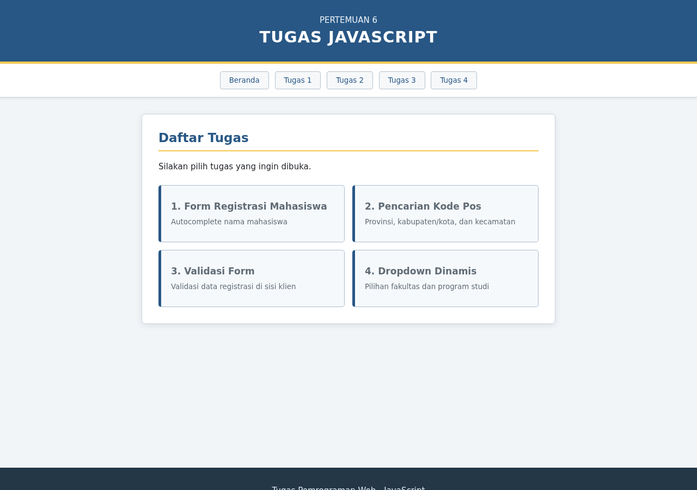
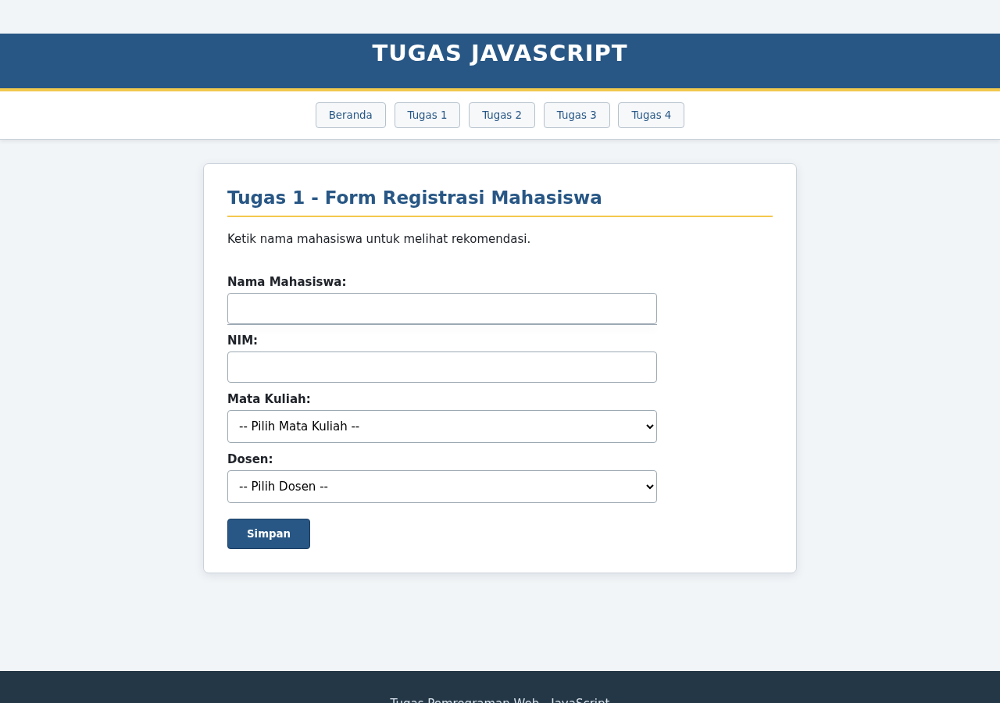
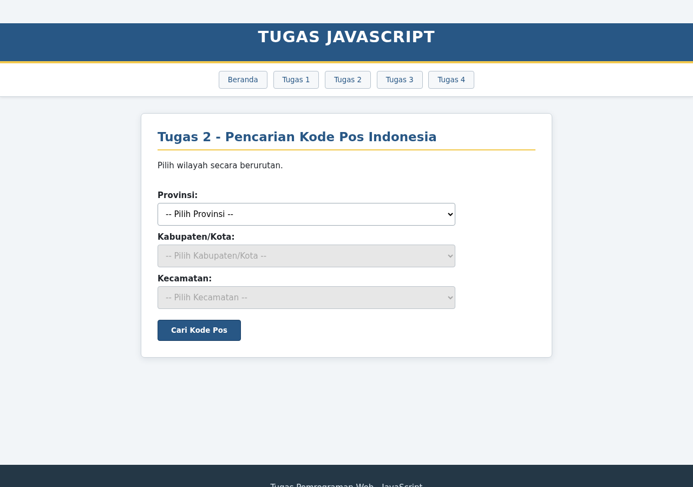
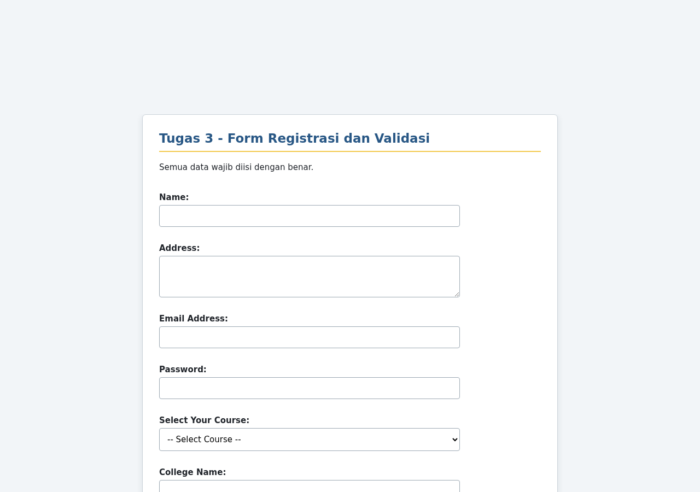
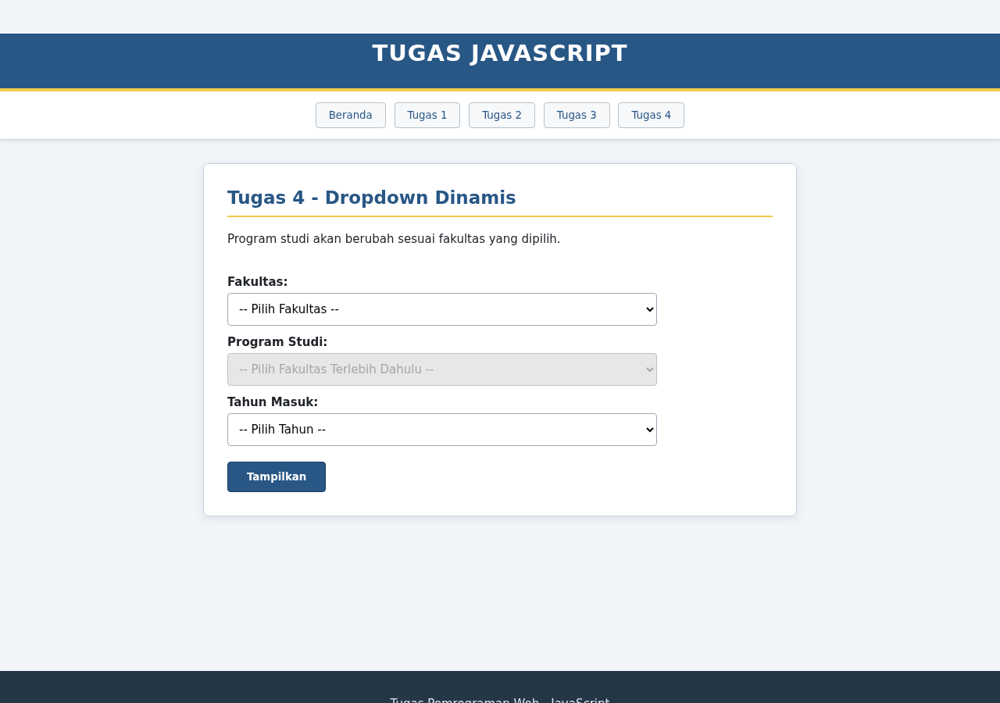

# Dokumentasi Tugas JavaScript — Pertemuan 6

**Nama:** Asher Yedijah Hoesono  
**NRP:** 5025251106

## Deskripsi

Tugas ini berisi empat latihan JavaScript sederhana dalam satu website. Program dibuat hanya menggunakan **HTML, CSS, dan JavaScript** tanpa framework atau library tambahan.

Link: https://www.pertemuan6asher.vercel.app

## Interface Utama

Halaman utama menyediakan menu untuk membuka masing-masing tugas.



## 1. Form Registrasi Mahasiswa

Form untuk mengisi nama mahasiswa, NIM, mata kuliah, dan dosen.



**Fitur:**

- Rekomendasi nama muncul ketika pengguna mengetik.
- Memilih nama akan mengisi NIM, mata kuliah, dan dosen secara otomatis.
- Menampilkan pesan setelah data berhasil disimpan.

**Langkah penggunaan:**

1. Ketik beberapa huruf pada kolom nama mahasiswa.
2. Pilih nama dari daftar rekomendasi.
3. Periksa data, lalu tekan tombol **Simpan**.

## 2. Pencarian Kode Pos Indonesia

Form pencarian kode pos berdasarkan data wilayah yang dipilih secara bertingkat.



**Fitur:**

- Dropdown Provinsi, Kabupaten/Kota, dan Kecamatan saling terhubung.
- Pilihan wilayah berikutnya menyesuaikan wilayah sebelumnya.
- Menampilkan kode pos dan daftar daerah atau kelurahan.

**Langkah penggunaan:**

1. Pilih provinsi.
2. Pilih kabupaten/kota dan kecamatan yang tersedia.
3. Tekan tombol **Cari Kode Pos** untuk melihat hasil.

## 3. Form Registrasi dan Validasi

Form registrasi dengan pemeriksaan data langsung di sisi klien.



**Fitur:**

- Memvalidasi nama, alamat, email, password, course, dan college.
- Email harus menggunakan format yang benar.
- Password minimal delapan karakter dan mengandung angka.
- Pesan kesalahan ditampilkan pada input yang belum valid.

**Langkah penggunaan:**

1. Isi seluruh data registrasi.
2. Pilih course yang diinginkan.
3. Tekan **Register**, lalu perbaiki data jika muncul pesan kesalahan.

## 4. Dropdown Dinamis

Form pemilihan program studi berdasarkan fakultas.



**Fitur:**

- Pilihan program studi berubah sesuai fakultas.
- Dropdown program studi tidak dapat digunakan sebelum fakultas dipilih.
- Menampilkan rangkuman fakultas, program studi, dan tahun masuk.

**Langkah penggunaan:**

1. Pilih fakultas.
2. Pilih program studi dan tahun masuk.
3. Tekan tombol **Tampilkan** untuk melihat hasil pilihan.

## Cara Menjalankan

1. Ekstrak file ZIP.
2. Buka file `index.html` menggunakan browser.
3. Gunakan menu di bagian atas untuk berpindah halaman.

## Struktur File

```text
index.html
style.css
script.js
README.md
docs/
└── images/
    ├── beranda.png
    ├── tugas1.png
    ├── tugas2.png
    ├── tugas3.png
    └── tugas4.png
```
